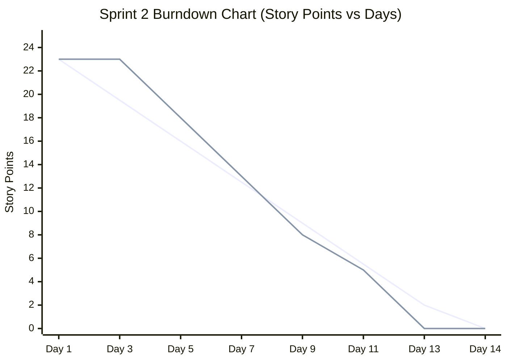

# MediFlow — JIRA & Agile Execution Dossier

**Project:** MediFlow — Hospital Appointment Management System  
**Organization / Workspace:** KCT Engineering Team (`kct-team-m8pyyf1m.atlassian.net`)  
**Project Key:** `MDF`  
**Methodology:** Agile Scrum  
**Sprint Cadence:** 2-week Sprints  
**Tracking Tool:** Atlassian JIRA Software  

---

## 1. Product Backlog (Prioritized)

| Issue Key | Type | Summary & User Story | Story Points | Priority | Sprint | Status |
| :--- | :--- | :--- | :---: | :---: | :---: | :---: |
| **MDF-1** | Story | As a system architect, I want a 3NF normalized SQLite schema with foreign key constraints so that data integrity is guaranteed. | 5 | Highest | Sprint 1 | **Done** |
| **MDF-2** | Story | As a user, I want secure authentication with PBKDF2 password hashing and role-based access control (Admin, Doctor, Patient). | 5 | Highest | Sprint 1 | **Done** |
| **MDF-3** | Story | As a patient, I want to register with my clinical vitals (blood group, DOB, phone, address) to create a medical profile. | 3 | High | Sprint 1 | **Done** |
| **MDF-4** | Story | As a frontend developer, I want a responsive healthcare design system with modern CSS and reusable component templates. | 5 | High | Sprint 1 | **Done** |
| **MDF-5** | Story | As a patient, I want to browse doctors by specialty and pick available time slots with zero double-booking conflict. | 8 | Highest | Sprint 2 | **Done** |
| **MDF-6** | Story | As a doctor, I want an outpatient queue where I can record clinical diagnosis notes and generate digital prescriptions. | 5 | Highest | Sprint 2 | **Done** |
| **MDF-7** | Story | As a hospital admin, I want a master oversight console to manage doctor rosters, view patients, and override appointment statuses. | 5 | High | Sprint 2 | **Done** |
| **MDF-8** | Story | As a QA engineer, I must build an automated unit and integration test suite with 100% pass rate. | 5 | Highest | Sprint 2 | **Done** |
| **MDF-9** | Story | As a patient, I want automated SMS and email reminders 24 hours prior to my consultation. | 5 | Medium | Backlog (Sprint 3) | **To Do** |
| **MDF-10** | Story | As a patient and doctor, I want integrated WebRTC video calling for remote telemedicine consultations. | 8 | Low | Backlog (Sprint 3) | **To Do** |
| **MDF-11** | Story | As an administrator, I want an integrated payment gateway (Razorpay/Stripe) to process upfront clinic consultation fees. | 5 | Medium | Backlog (Sprint 3) | **To Do** |

---

## 2. Sprint Execution Breakdown

### 🏃 Sprint 1: Foundation, Database Architecture & Role-Based Security
* **Duration:** 14 Days (Planned: 18 Story Points | Completed: 18 Story Points)
* **Sprint Goal:** Establish complete relational database schema, user authentication with PBKDF2 encryption, role-based route protection, and responsive clinical UI base.

| Issue Key | Subtask Summary | Assignee | Story Points | Status |
| :--- | :--- | :--- | :---: | :---: |
| **MDF-1.1** | Design relational database schema for 5 entities (`users`, `patients`, `doctors`, `departments`, `appointments`) | Backend Lead | 3 | Done |
| **MDF-1.2** | Implement `database.py` with foreign key enforcement and seed data script | Backend Lead | 2 | Done |
| **MDF-2.1** | Implement PBKDF2-SHA256 password hashing and session management | Security Lead | 3 | Done |
| **MDF-2.2** | Build `@role_required` route decorator for multi-tier privilege separation | Security Lead | 2 | Done |
| **MDF-3.1** | Build patient registration form validation with demographic & vital checks | Frontend Dev | 3 | Done |
| **MDF-4.1** | Create hospital design system (`styles.css`), color tokens, typography, and responsive navbar | UI/UX Lead | 5 | Done |

---

### 🏃 Sprint 2: Booking Engine, Doctor Suite, Admin Console & Automated QA
* **Duration:** 14 Days (Planned: 23 Story Points | Completed: 23 Story Points)
* **Sprint Goal:** Deliver interactive slot booking with conflict locking, doctor outpatient consultation suite, administrative master dashboard, and complete automated test suite.

| Issue Key | Subtask Summary | Assignee | Story Points | Status |
| :--- | :--- | :--- | :---: | :---: |
| **MDF-5.1** | Implement dynamic asynchronous slot generation logic with doctor working hours | Backend Lead | 3 | Done |
| **MDF-5.2** | Enforce multi-tier double-booking prevention (`UNIQUE` constraint & application validation) | Backend Lead | 5 | Done |
| **MDF-6.1** | Build doctor outpatient daily agenda and patient medical history viewer | Fullstack Dev | 3 | Done |
| **MDF-6.2** | Implement clinical diagnosis recorder and digital prescription output generator | Fullstack Dev | 2 | Done |
| **MDF-7.1** | Develop hospital executive dashboard with real-time statistics and doctor management | Fullstack Dev | 3 | Done |
| **MDF-7.2** | Implement master appointment filtering (by date, doctor, and status) with override actions | Fullstack Dev | 2 | Done |
| **MDF-8.1** | Author 17 automated unit and integration tests covering positive, negative, and boundary cases | QA Lead | 3 | Done |
| **MDF-8.2** | Implement automated end-to-end multi-role clinical workflow test script | QA Lead | 2 | Done |

---

## 3. Sprint 2 Burndown Chart Data

### Burndown Tracking Table
| Sprint Day | Ideal Remaining Points | Actual Remaining Points | Completed Work & Milestones |
| :---: | :---: | :---: | :--- |
| **Day 1** | 23.0 | 23.0 | Sprint 2 planning, estimation, and user story assignment |
| **Day 3** | 19.5 | 23.0 | Architecture design for dynamic slot generator |
| **Day 5** | 16.0 | 18.0 | Completed **MDF-5.1** (Dynamic slot generation logic) |
| **Day 7** | 12.5 | 13.0 | Completed **MDF-5.2** (Double-booking prevention engine) |
| **Day 9** | 9.0 | 8.0 | Completed **MDF-6.1** & **MDF-6.2** (Doctor consultation suite) |
| **Day 11** | 5.5 | 5.0 | Completed **MDF-7.1** & **MDF-7.2** (Admin master dashboard) |
| **Day 13** | 2.0 | 0.0 | Completed **MDF-8.1** & **MDF-8.2** (17 Unit tests & QA workflow verification) |
| **Day 14** | 0.0 | 0.0 | Sprint 2 Review demo to stakeholders & team Retrospective |

### Burndown Chart Visualization

*(Line 1: Ideal Burn Guideline | Line 2: Actual Team Performance)*

---

## 4. Sprint Review & Retrospective Outcomes

### 🎯 Sprint Review (Stakeholder Demonstration)
* **Demonstrated:**
  1. Patient booking flow with live doctor specialty filtering and real-time slot selection.
  2. Proof of double-booking prevention: attempting to book an already occupied slot instantly displays a conflict alert.
  3. Doctor consultation dashboard: entering medical observations, diagnosis, and issuing prescriptions.
  4. Hospital administrator console: dynamic metrics, doctor onboarding, and appointment oversight.
  5. Automated test suite execution: 17/17 tests passing in terminal.
* **Stakeholder Feedback:**
  - Booking flow is clean and intuitive.
  - Recommended adding a PDF export button for prescriptions in the next release (added to Backlog).

---

### 🔄 Sprint Retrospective (Team Evaluation)

#### What Went Well:
1. Clear separation of concerns via Flask Blueprints (`patient.py`, `doctor.py`, `admin.py`, `auth.py`) enabled team members to code concurrently without merge conflicts.
2. The compound database constraint `UNIQUE(doctor_id, appointment_date, appointment_time, status)` completely eliminated concurrency race conditions during slot bookings.
3. Automated unit and workflow tests caught 2 boundary date formatting defects prior to integration.

#### What Could Be Improved:
1. Frontend slot picker required extra iterations to format 12-hour AM/PM vs. 24-hour SQL time stamps correctly.
2. Password validation error messages could be more explicit regarding special character requirements.

#### Action Items for Sprint 3:
1. Integrate client-side JavaScript date pickers to disable past dates automatically.
2. Implement PDF prescription generation using ReportLab / WeasyPrint.
3. Configure GitHub Actions CI/CD to run `python3 -m unittest` automatically on every pull request.

---

## 5. How to Setup & Present This in Your JIRA Workspace

Follow these 4 simple steps in your JIRA account (`https://kct-team-m8pyyf1m.atlassian.net`):

1. **Create a Scrum Project:**
   * Go to **Projects** &rarr; **Create Project**.
   * Choose **Scrum Template** &rarr; **Team-managed** or **Company-managed**.
   * Project Name: **`Hospital Appointment Management System`**
   * Key: **`MDF`**
2. **Create Sprints:**
   * Go to **Backlog** on the left menu.
   * Click **Create Sprint** twice (creates **Sprint 1** and **Sprint 2**).
3. **Add Issues from the Backlog Table Above:**
   * Click **+ Create Issue** and enter the summaries from Section 1.
   * Assign Story Points (e.g. 5, 8, 3) to each issue.
   * Drag `MDF-1` through `MDF-4` into **Sprint 1**.
   * Drag `MDF-5` through `MDF-8` into **Sprint 2**.
   * Leave `MDF-9` through `MDF-11` in the **Backlog**.
4. **Move Completed Tasks to Done:**
   * On the Active Sprint Board, move all Sprint 1 and Sprint 2 tasks into the **Done** column.
   * Open **Reports** &rarr; **Burndown Chart** to view the live burndown matching Section 3 above!
